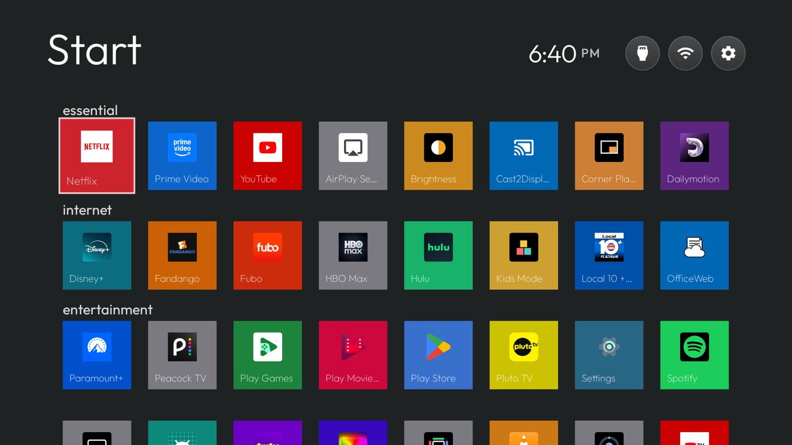

# Retro Launchers

A fork of this repo's launcher with two tributes to classic TV home screens, and the nine theme switches that
build them. The switches were offered upstream (#2580, #2581, #2582) and turned down to keep the core launcher
small, so they live here.

| 2014 Leanback Launcher | Retro Metro Launcher |
|---|---|
|  |  |

- **[2014 Leanback Launcher](themes/leanback-2014/README.md):** the first Android TV home screen. A blue
  microphone orb at the top left, the time alone at the top right, banner rows with headings over the focused
  app's artwork, and Inputs, Wi-Fi and Settings as round buttons at the end of the page.
- **[Retro Metro Launcher](themes/retro-metro/README.md):** Windows 8 and the Xbox 360 dashboard. A big
  "Start", square, flat, coloured tiles with the name inside, and lower-case group headings.

Both are unofficial tributes made only from the launcher's own keys: no Google or Microsoft logos, artwork or
code.

## The switches

All are off by default, so without one of these themes the launcher looks as upstream's does.

| Key | What it does |
|---|---|
| `tile_corner_radius` | Tile corner radius in dp (0 to 24, default 16) |
| `tile_shape` | `square` makes tiles as tall as they are wide (default `banner`) |
| `flat_tiles` | With `uniform_tiles`, each card is one flat colour taken from its icon |
| `tile_label_inside` | With `uniform_tiles`, the name sits inside the card at its bottom left |
| `row_titles` | A small heading above each row, in order |
| `home_title` | A large title in place of the clock and date ("Start"); the clock moves to the top right |
| `clock_right` | The time at the top right, without the date |
| `search_orb` | A round search button of this colour at the top left, with a microphone; OK opens the TV's search |
| `buttons_at_end` | Inputs, Wi-Fi and Settings as a row of round buttons after the last row of tiles |

More detail with screenshots: [docs/switches.md](docs/switches.md) and [themes/README.md](themes/README.md).

## Install

Build the launcher from this branch, install it, then push a theme over Wi-Fi:

```sh
cd launcher && ./gradlew assembleRelease
adb install -r app/build/outputs/apk/release/app-release.apk
TV_HOST=<tv ip> tools/theme.sh themes/leanback-2014    # or themes/retro-metro; --reset to undo
```

Tested on an ASUS/MOKA M1G, Android TV 11. The search orb needs a search app on the TV; without one it says it
can't open search.
